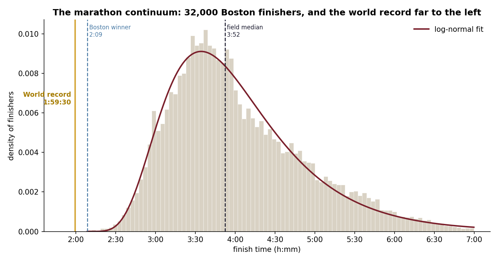
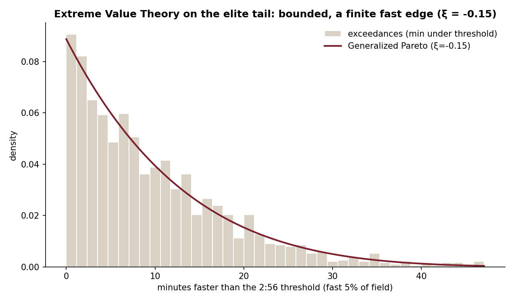
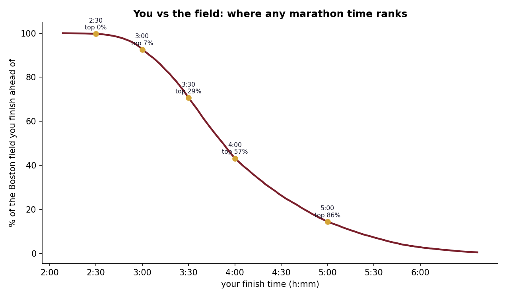

# The Marathon Performance Continuum

*One distribution from the back of the field to the world record.*

Every one of the 31,842 finishers of the 2014 Boston Marathon was slower than the world record. The fastest was the winner, in 2:09, and Kelvin Kiptum's 2:00:35 sits to the left of the entire field. I wanted to see that gap on one time axis, with a club runner's finish and the record as two points on the same curve. (My own best, 2:48, finishes ahead of 97.5% of this field, counted from the same finisher file.) Boston 2014 gave me a full field to draw the curve from.

## The shape of a field

  

A marathon field is close to log-normal: it climbs to a peak around 3:30 to 3:50, then trails off slowly past six hours. The median Boston finisher ran 3:52, and the slow tail pulls the mean to 4:03 (standard deviation 51 minutes). A shifted log-normal with a floor at 118 minutes tracks the histogram closely.

The record is off the left edge of that curve. None of the 31,842 finishers ran faster, and against this field it is 2.4 standard deviations below the mean; the median runner took 93% longer.

## Where the fast edge ends

  

The log-normal is a good description of the middle of the field and a poor one of its extreme fast end, so the tail gets its own model from Extreme Value Theory. I set a threshold at the fastest 5% of finishers (2:56, which leaves 1,593 runners), measured how far each of them beat it, and fitted a generalized Pareto distribution to those gaps; this is the Peaks-Over-Threshold method.

The fitted shape parameter is ξ = −0.147. A negative shape means the tail is bounded, so fast performances stop at some finite point. The method can tell whether a bound exists but is poor at locating it, which is why I don't quote a fastest possible time.

## Where your time lands

  

The lookup turns a finish time into a place in the field (`tables/you_vs_goat.csv`):

| Finish time | Ahead of this share of the field | Slower than 2:00:35 by |
|---|---|---|
| 2:30 | 99.7% | 24.4% |
| 3:00 | 92.6% | 49.3% |
| 3:30 | 70.6% | 74.2% |
| 4:00 | 43.2% | 99.0% |
| 5:00 | 14.4% | 148.8% |
| 6:00 | 2.8% | 198.5% |

A 3:00 marathon is a serious amateur result, and it beats 92.6% of an already fast field while still being 49% slower than the record. A 4:00 takes almost exactly twice as long as the record.

## What the numbers don't cover

Boston is a qualifying race, and its field is made of runners who were fast enough to get in. Every percentile here is about this field; a general-entry race would shift the whole curve slower and put the record further out. It is also one race in one year. (The 2013 race was stopped partway through and is left out.)

I don't give the record's rarity as "1 in N", because that would mean trusting the fitted density well beyond the data. The record is described by what was observed: faster than every finisher, 2.4 standard deviations from the mean.

The record is set in `analyze.py` as Kiptum's 2:00:35 (Chicago, 2023). A faster record would move that one mark and none of the field statistics.

*Code: [github.com/lyhjeremy/marathon-performance-continuum](https://github.com/lyhjeremy/marathon-performance-continuum)*
